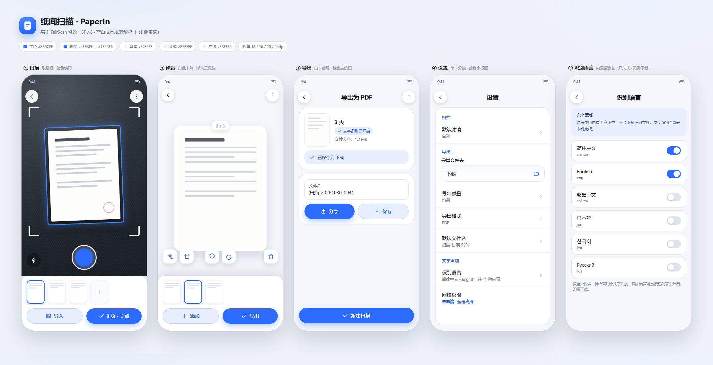

# 纸间扫描 / PaperIn

一个**干净、离线、无水印**的 Android 文档扫描应用：拍照 → 自动识别边缘 → 自动校正 → 一键导出 PDF。

界面采用**蓝白配色**（夸克扫描王风格）：白色分层卡片 + 蓝色主色，取景框四角标、蓝色快门、胶囊按钮。

> **本应用是 [FairScan](https://github.com/pynicolas/FairScan) 的修改版本**，依据 GNU GPLv3 分发。
> 与 FairScan 项目无隶属或背书关系。改动明细见 [MODIFICATIONS.md](MODIFICATIONS.md)，
> 合规要点见 [COMPLIANCE.md](COMPLIANCE.md)。



> 五屏依次为：拍照取景、页面预览、导出设置、设置、识别语言。
> 可交互版本见 [`preview/ui-preview.html`](preview/ui-preview.html)。

---

## 功能

- 自动文档检测（自训练分割模型，LiteRT 推理）与透视校正
- 自动图像增强、彩色 / 灰度 / 黑白三种滤镜，纸面提白 + 边缘锐化，默认导出 A4 约 300 dpi（扫描仪规格）
- 拍照、相册多选导入、页面拖动排序、旋转、手动微调裁切
- 导出 PDF / JPEG，直接保存或分享
- 内置 OCR（Tesseract，11 种语言，全部打包在 APK 内）
- **完全离线**：不申请 INTERNET 权限，无账号、无广告、无统计，安装后拔掉网线也能用全部功能

## 离线设计

这不是"打开时先联网校验"式的伪离线，而是在权限层面就断绝了联网可能：

| 环节 | 做法 |
| --- | --- |
| 网络权限 | `AndroidManifest.xml` 中 `<uses-permission android:name="android.permission.INTERNET" tools:node="remove" />`，即使依赖库（media3）带入该权限也会被合并移除，最终 APK 无法建立任何 socket |
| 文档分割模型 | `app/models/document-segmentation.tflite` 随仓库提供，构建时直接拷进 assets，不联网 |
| OCR 语言包 | `app/src/main/assets/tessdata/*.traineddata` 打进 APK，首次启动复制到私有目录，无需下载 |
| 默认语言 | 首启按系统语言自动启用（简体/繁体中文、英、日、韩、俄、德、法、西、越、泰），开箱即可识别 |
| 用户数据 | 图片、PDF、日志全部留在本机，不上传 |

> 内置语言：`chi_sim` `chi_tra` `eng` `jpn` `kor` `rus` `deu` `fra` `spa` `tha` `vie`
> （tessdata_fast，约 23 MB；模型另 4.7 MB）。APK 因此比不内置版本大约 28 MB，
> 换来的是「装完即用、断网可用、无任何联网权限」。
>
> 要增删语言：把对应 `.traineddata` 放进 `assets/tessdata/`，加入
> `OcrLanguage.AVAILABLE_LANGUAGE_CODES`，并更新 `assets/tessdata/sha256.txt`，
> 代码无需其它改动。校验：`cd app/src/main/assets/tessdata && sha256sum -c sha256.txt`

## 技术栈

Kotlin · Jetpack Compose (Material 3) · CameraX · LiteRT · OpenCV · Tesseract4Android · PDFBox-Android

| 模块 | 说明 |
| --- | --- |
| `app` | UI、相机、导出、设置（包名 `com.paperin.scan`） |
| `imageprocessing` | 文档检测、透视校正、二值化、OCR 封装 |
| `evaluation` | 离线评估工具（不打包进 APK） |

## 构建

环境：Android Studio（JDK 17+）、Android SDK 37、Gradle Wrapper。

```bash
# 调试包
./gradlew :app:assembleDebug

# 发布包（多 ABI 拆包）
./gradlew clean check assembleRelease

# App Bundle
./gradlew clean check :app:bundleRelease
```

构建**不需要联网**：文档分割模型已随仓库提供在 `app/models/document-segmentation.tflite`，
构建时由 `prepareTFLiteModel` 任务拷进 assets。

```bash
# 完全离线构建
./gradlew --offline :app:assembleDebug
```

如果 `app/models/` 里没有模型（例如只 checkout 了源码），任务会尝试从 GitHub Releases
下载一次；仍然失败时构建会直接报错，而不会产出一个缺模型的 APK。

正式签名包由 GitHub Actions 自动产出，见 [`.github/workflows/README.md`](.github/workflows/README.md)。

## UI 规范摘要

| 项目 | 值 |
| --- | --- |
| 主色 | `#2B6CFF`，渐变 `#4E8BFF → #1F5CF6` |
| 页面背景 | `#F4F6FB` |
| 卡片 | 纯白 `#FFFFFF`，圆角 16 / 20 / 24dp，1dp `#EBEFF6` 细边 |
| 主按钮 | 蓝色胶囊，高 48dp，圆角 `CircleShape` |
| 次按钮 | 淡蓝底 `#E7EFFF` + 蓝字胶囊 |
| 取景框 | 白色四角标（未检测）→ 蓝色（已检测） |
| 字号 | 标题 20/26sp SemiBold，正文 14/16sp |

主题入口：`app/src/main/java/com/paperin/scan/ui/theme/`（`Color.kt` / `Theme.kt` / `Type.kt`）。
所有页面统一走 `PaperInTheme`，改色只改 `Color.kt` 与 `Brand` 对象即可。

## 许可证

GNU General Public License v3.0，见 [LICENSE](LICENSE)。

原项目：FairScan，Copyright 2025-2026 The FairScan authors。
本修改版本：Copyright 2026 The PaperIn authors。
